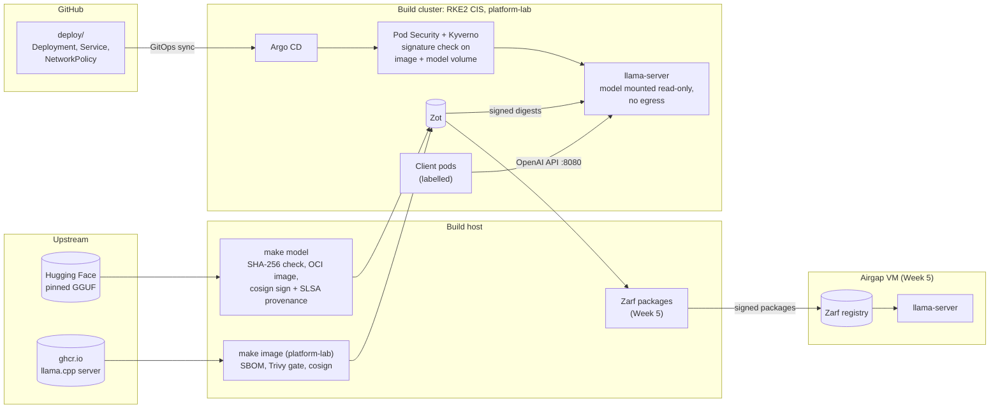
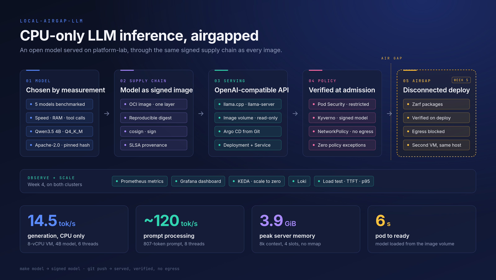

# local-airgap-LLM

An openly licensed, quantized LLM served on CPU inside the
[platform-lab](https://github.com/JGGHalfhide/platform-lab) Kubernetes
platform, delivered through the same supply chain as every image (signed,
verified at admission), scaled and observed, and deployed to an airgapped
cluster with no internet.

**Status:** Week 3 of 6: an OpenAI-compatible endpoint on the build cluster, synced by Argo CD, the model verified at admission ([docs/stack.md](docs/stack.md)). See [ROADMAP.md](ROADMAP.md).

## Architecture

Every tool, its version, why it was chosen, the pipeline and the data flow:
[docs/stack.md](docs/stack.md).

## How it fits with platform-lab

- **platform-lab** provides the clusters: VMs (Terraform), OS hardening, RKE2,
  Argo CD, Zot, Kyverno, cosign, monitoring, Velero, Zarf.
- **This repo** provides the workload: the model as a signed OCI artifact,
  the llama.cpp inference server manifests, KEDA scaling, dashboards, the
  Zarf packages for the airgapped cluster, load tests and results.

## Results

To come: tokens/s, time to first token, p50/p95 latency, cold start and cost
per million tokens on this hardware (8-core Ryzen 7 8845HS, CPU only).

## Decisions

Architecture decision records are in [docs/adr/](docs/adr/).

## License

[MIT](LICENSE). Model weights are not in this repo; each model's source,
license and SHA-256 are recorded in the docs.
