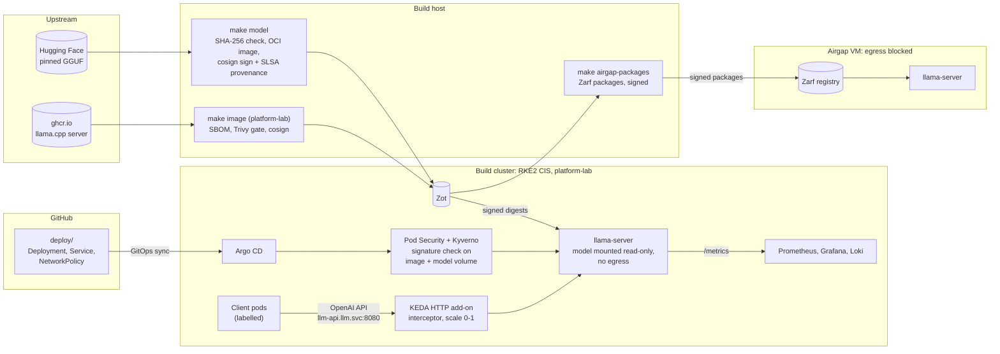

# local-airgap-LLM

An openly licensed, quantized LLM served on CPU inside the
[platform-lab](https://github.com/JGGHalfhide/platform-lab) Kubernetes
platform, delivered through the same supply chain as every image (signed,
verified at admission), scaled and observed, and deployed to an airgapped
cluster with no internet.

[](https://github.com/JGGHalfhide/local-airgap-LLM/actions/workflows/ci.yml)

**Status:** v1.1 (11/23): endpoint on the build cluster and the airgapped
VM, scale to zero (cold start ~6 s), load-tested (18 tokens/s at 4
concurrent requests, 0.75 kWh per million output tokens), both clusters
rebuilt from fresh clones ([scans/week6-rebuild.txt](docs/scans/week6-rebuild.txt)),
and Qwen3.5's thinking off unless a request opts in
([ADR 0006](docs/adr/0006-thinking-off-by-default.md)).
See [ROADMAP.md](ROADMAP.md).

## Architecture




Every tool, its version, why it was chosen, the pipeline and the data flow:
[docs/stack.md](docs/stack.md).

## How it fits with platform-lab

- **platform-lab** provides the clusters: VMs (Terraform), OS hardening, RKE2,
  Argo CD, Zot, Kyverno, cosign, monitoring, Velero, Zarf.
- **This repo** provides the workload: the model as a signed OCI artifact,
  the llama.cpp inference server manifests, KEDA scaling, dashboards, the
  Zarf packages for the airgapped cluster, load tests and results.

## Results

Qwen3.5 4B Q4_K_M ([ADR 0002](docs/adr/0002-qwen3.5-4b-q4km-model.md)) on
llama.cpp, CPU only: Ryzen 7 8845HS (8 cores), one 8 vCPU / 16 GiB VM with
the full platform stack.

| Measure | Result | Details |
|---|---|---|
| Generation, one stream | 14.3 tokens/s | [load-test.md](docs/load-test.md) |
| Time to first token, 213-token prompt | 1.9 s p50, 2.1 s p95 | [load-test.md](docs/load-test.md) |
| Throughput, 4 concurrent requests (the server's 4 slots) | 18.2 tokens/s; TTFT 2.6 s p50 / 8.0 s p95; latency 20.5 s p50 / 30.0 s p95 (128 tokens) | [load-test.md](docs/load-test.md) |
| 8 concurrent requests | 18.7 tokens/s; requests queue, TTFT 22 s p50 | [load-test.md](docs/load-test.md) |
| Errors under load | 0 of 64 (after fixing an OOM the load test found) | [load-test.md](docs/load-test.md#finding-oomkilled-under-load-fixed) |
| Agent tool loops (27 multi-turn requests, 1k-7k tokens) | Peak 5.3 GiB, 0 errors with `--ctx-checkpoints 4`; OOMKilled at 6 GiB with the default | [ADR 0007](docs/adr/0007-context-checkpoints-capped-at-4.md), [scan](docs/scans/agent-mem-replay.txt) |
| Energy per million output tokens | 0.75 kWh at 4 concurrent, 1.27 kWh one stream (CPU package, RAPL; a lower bound for the wall) | [load-test.md](docs/load-test.md#energy-per-million-tokens) |
| Cold start, zero replicas to first byte | 6.2-6.4 s build cluster, 5.9-6.8 s airgapped | [scaling.md](docs/scaling.md), [airgap-runbook.md](docs/airgap-runbook.md) |
| Airgapped deploy, egress blocked | 7m48s, 0 image pull errors, signed model verified at admission | [airgap-runbook.md](docs/airgap-runbook.md) |
| Thinking (opt-in per request, budget 1024 tokens) | Fixed 3/3 multi-step errors at 10-68 s per answer; without a budget, open-ended questions looped for 10 min | [ADR 0006](docs/adr/0006-thinking-off-by-default.md) |
| Model benchmark (host, llama-bench) | pp512 145 tokens/s, tg128 16.6 tokens/s at 8 threads | [benchmarks/README.md](benchmarks/README.md) |

## Quickstart

From an empty machine, all three repos in order (platform-lab, this repo,
local-agents):
[build guide](https://github.com/JGGHalfhide/platform-lab/blob/main/docs/build-guide.md).

Needs [platform-lab](https://github.com/JGGHalfhide/platform-lab) v1.0+
cloned next to this repo (`../platform-lab`), its prerequisites and Vault,
and its build cluster up. Platform-lab's root Argo CD app includes an
Application for this repo's `deploy/`.

```bash
# In platform-lab: build cluster, Argo CD, and the images its manifests pin
cd ../platform-lab
make up
# The registry starts empty: publish every image the manifests pin, by
# tag@digest (a tag alone can move upstream and miss the pinned digest).
make image IMAGE=docker.io/stefanprodan/podinfo:6.17.0@sha256:fa2f27c1a8561097e5144bfc0853eba6054d743b68b03de4cad4675616ddefb0
make image IMAGE=docker.io/library/postgres:17.12-alpine3.24@sha256:a77aa70e641402a21411b92b721c58d10f23b50ae5fdd2333efd22d166e1e5f7
make image IMAGE=docker.io/velero/velero:v1.18.4@sha256:c89fb5b6d1fd6afd368e0f483e6f5555fd62851a1eada8ac5c72482e674ca17b
make image IMAGE=ghcr.io/kedacore/keda:2.21.1@sha256:d09d92c0a310e3057a3c54df387b99abf2bf31352218dbe1adcb00e807886488
make image IMAGE=ghcr.io/kedacore/keda-metrics-apiserver:2.21.1@sha256:747e376b3e80dc4f72bf4f7043f47cc4cdb56f34b1aed9531789f474996e1c84
make image IMAGE=ghcr.io/kedacore/keda-admission-webhooks:2.21.1@sha256:5f4b0b0f7831b9f53738be85e99449a1747a5effa970305fe602455ab0f4fcd3
make image IMAGE=ghcr.io/kedacore/http-add-on-operator:0.16.0@sha256:2ae0076d549fb7d12b3d9ecb1e87d035c7ee73e94a640ff53842e70ab0824da0
make image IMAGE=ghcr.io/kedacore/http-add-on-interceptor:0.16.0@sha256:3a9a454b949edd5dee711ed14e603cc3b91b7c065905ecc251fe0a56a4c026f1
make image IMAGE=ghcr.io/kedacore/http-add-on-scaler:0.16.0@sha256:db5223b1a37521ec0f099ac04785bfc069f5c3ebf4bacffd04e5127b0876dffb
# This repo's runtime, and alpine for the smoke test's client pods
make image IMAGE=ghcr.io/ggml-org/llama.cpp:server-v1.0.0-b12359-b1b770d@sha256:e3032ea0712da96dec820c770626385de4322dd06619fb5829256a504bbc9375
make image IMAGE=docker.io/library/alpine:3.22@sha256:49340b346798875b5592e5d420241f2f9cfba5f47e62ebb1446a1b34734e898f

# Here: the model as a signed OCI image (downloads 2.8 GiB, checks SHA-256)
cd ../local-airgap-LLM
make model

# Argo CD syncs deploy/ once the images are in Zot (pods that tried to pull
# earlier retry within 5 minutes). Then:
export KUBECONFIG=../platform-lab/kubeconfig
make smoke                       # completion, NetworkPolicy, no egress, unsigned model rejected
scripts/cold-start.sh 3          # scale from zero
scripts/load-test.py --rapl      # concurrency 1/2/4/8 (--rapl needs sudo)
```

Airgapped cluster: [docs/airgap-runbook.md](docs/airgap-runbook.md)
(`make airgap-packages`, then platform-lab's `make airgap-up` and
`make airgap-disconnect`, then `make airgap-deploy` and `make smoke`).

## Decisions

Architecture decision records are in [docs/adr/](docs/adr/): runtime
(0001), model (0002), model as an OCI image volume (0003), plain Deployment
over KServe (0004), scale to zero with KEDA (0005), thinking off by default
(0006), context checkpoints capped at 4 (0007).

## License

[MIT](LICENSE). Model weights are not in this repo; each model's source,
license and SHA-256 are recorded in the docs.
