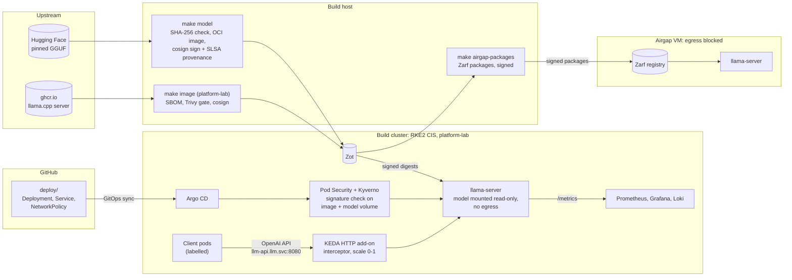

# local-airgap-LLM

An openly licensed, quantized LLM served on CPU inside the
[platform-lab](https://github.com/JGGHalfhide/platform-lab) Kubernetes
platform, delivered through the same supply chain as every image (signed,
verified at admission), scaled and observed, and deployed to an airgapped
cluster with no internet.

[](https://github.com/JGGHalfhide/local-airgap-LLM/actions/workflows/ci.yml)

**Status:** Week 6 of 6: endpoint on the build cluster and the airgapped VM,
scale to zero (cold start ~6 s), load-tested (18 tokens/s at 4 concurrent
requests, 0.75 kWh per million output tokens). Full rebuild and v1.0 next.
See [ROADMAP.md](ROADMAP.md).

## Architecture




Every tool, its version, why it was chosen, the pipeline and the data flow:
[docs/stack.md](docs/stack.md).

## How it fits with platform-lab

- **platform-lab** provides the clusters: VMs (Terraform), OS hardening, RKE2,
  Argo CD, Zot, Kyverno, cosign, monitoring, Velero, Zarf.
- **This repo** provides the workload: the model as a signed OCI artifact,
  the llama.cpp inference server manifests, KEDA scaling, dashboards, the
  Zarf packages for the airgapped cluster, load tests and results.

## Results

Qwen3.5 4B Q4_K_M ([ADR 0002](docs/adr/0002-qwen3.5-4b-q4km-model.md)) on
llama.cpp, CPU only: Ryzen 7 8845HS (8 cores), one 8 vCPU / 16 GiB VM with
the full platform stack.

| Measure | Result | Details |
|---|---|---|
| Generation, one stream | 14.3 tokens/s | [load-test.md](docs/load-test.md) |
| Time to first token, 213-token prompt | 1.9 s p50, 2.1 s p95 | [load-test.md](docs/load-test.md) |
| Throughput, 4 concurrent requests (the server's 4 slots) | 18.2 tokens/s; TTFT 2.6 s p50 / 8.0 s p95; latency 20.5 s p50 / 30.0 s p95 (128 tokens) | [load-test.md](docs/load-test.md) |
| 8 concurrent requests | 18.7 tokens/s; requests queue, TTFT 22 s p50 | [load-test.md](docs/load-test.md) |
| Errors under load | 0 of 64 (after fixing an OOM the load test found) | [load-test.md](docs/load-test.md#finding-oomkilled-under-load-fixed) |
| Energy per million output tokens | 0.75 kWh at 4 concurrent, 1.27 kWh one stream (CPU package, RAPL; a lower bound for the wall) | [load-test.md](docs/load-test.md#energy-per-million-tokens) |
| Cold start, zero replicas to first byte | 6.2-6.4 s build cluster, 5.9-6.8 s airgapped | [scaling.md](docs/scaling.md), [airgap-runbook.md](docs/airgap-runbook.md) |
| Airgapped deploy, egress blocked | 7m48s, 0 image pull errors, signed model verified at admission | [airgap-runbook.md](docs/airgap-runbook.md) |
| Model benchmark (host, llama-bench) | pp512 145 tokens/s, tg128 16.6 tokens/s at 8 threads | [benchmarks/README.md](benchmarks/README.md) |

## Quickstart

Needs [platform-lab](https://github.com/JGGHalfhide/platform-lab) v1.0+
cloned next to this repo (`../platform-lab`), its prerequisites and Vault,
and its build cluster up. Platform-lab's root Argo CD app includes an
Application for this repo's `deploy/`.

```bash
# In platform-lab: build cluster, Argo CD, and the images its manifests pin
cd ../platform-lab
make up
make image IMAGE=ghcr.io/ggml-org/llama.cpp:server-v1.0.0-b12359-b1b770d   # runtime
# ...plus the platform's images (its README) and KEDA's six
# (gitops/keda/kustomization.yaml)

# Here: the model as a signed OCI image (downloads 2.8 GiB, checks SHA-256)
cd ../local-airgap-LLM
make model

# Argo CD syncs deploy/ once the images are in Zot. Then:
export KUBECONFIG=../platform-lab/kubeconfig
make smoke                       # completion, NetworkPolicy, no egress, unsigned model rejected
scripts/cold-start.sh 3          # scale from zero
scripts/load-test.py --rapl      # concurrency 1/2/4/8 (--rapl needs sudo)
```

Airgapped cluster: [docs/airgap-runbook.md](docs/airgap-runbook.md)
(`make airgap-packages`, then platform-lab's `make airgap-up` and
`make airgap-disconnect`, then `make airgap-deploy` and `make smoke`).

## Decisions

Architecture decision records are in [docs/adr/](docs/adr/).

## License

[MIT](LICENSE). Model weights are not in this repo; each model's source,
license and SHA-256 are recorded in the docs.
