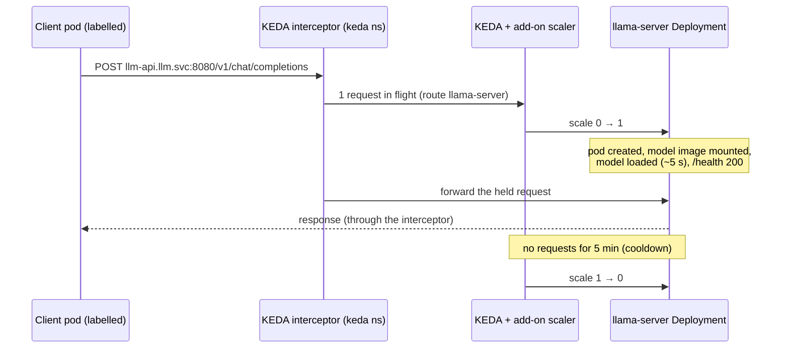

# Scaling and cold start

How the inference server scales to zero and back, and what a cold start
costs. Decision and alternatives: [ADR 0005](adr/0005-keda-http-add-on-scale-to-zero.md).
Manifests: `deploy/llm/scaling.yaml`; KEDA itself: platform-lab `gitops/keda`.

## How it works

| Setting | Value | Why |
|---|---|---|
| Replicas | 0-1 | One 5-6 GiB replica fits on the 16 GiB node, not two |
| Scaling metric | concurrency, target 4 per replica | The server has 4 slots |
| Cooldown | 300 s | Idle time before scaling to zero |
| Readiness timeout | 180 s | How long a held request waits; a cold start is ~6 s with images cached, longer if the 2.8 GiB model image has to be pulled again |
| Pending requests while cold | up to 32, then HTTP 503 | Bounded memory in the interceptor |
| Response timeouts | none | A non-streamed reply sends headers only when done; long prompts take minutes |

Clients call `http://llm-api.llm.svc:8080` (an ExternalName Service for the
interceptor). The server's NetworkPolicy admits only the interceptor and
Prometheus: a request sent past the interceptor would not count as in
flight, and KEDA could scale the server down under it.

## Cold start (11/22, build cluster)

`scripts/cold-start.sh 3`: waits until KEDA has scaled the server to zero,
sends one streamed chat completion (16 tokens max, thinking off) from a
labelled client pod, reads the new pod's timeline, then repeats the request
warm. Images cached on the node. Raw output:
[scans/week4-cold-start.txt](scans/week4-cold-start.txt).

| Run | Cold: first byte | Cold: reply done | Pod ready after the request | Warm: first byte | Warm: reply done |
|---|---|---|---|---|---|
| 1 | 6.39 s | 6.80 s | +6 s | 0.007 s | 0.21 s |
| 2 | 6.22 s | 6.65 s | +6 s | 0.008 s | 0.26 s |
| 3 | 6.20 s | 6.65 s | +7 s | 0.008 s | 0.21 s |

- **About 6.3 s from a request at zero to the first byte**, 6.7 s to a
  complete short reply. Warm, the same reply takes about 0.2 s.
- The pod exists within a second of the request and its container starts
  at +1 s; the remaining ~5 s is llama-server loading the 2.8 GiB model
  without mmap and repacking the weights for the CPU (log: model loaded at
  3-4 s after process start), then the startup probe (5 s period) seeing
  `/health` return 200.
- "First byte" is the response headers, which the interceptor can only
  send once the backend answers, so for a cold start it covers the whole
  wake-up. curl cannot time the first streamed token separately; "reply
  done" (a few tokens later) bounds it from above.
- Scale-down: in every run KEDA returned the server to zero 5 minutes after
  the last request (operator log: scaled up 18:44:30, down 18:49:37).

Under load (Week 6): [load-test.md](load-test.md). Not measured: a cold
start with the model image evicted from the node (the pull from Zot adds
the 2.8 GiB transfer). The startup probe period (5 s) sets the granularity
of the ready time; a 1-2 s period could cut up to ~4 s from the cold start at the cost
of more probe traffic.

## Limitation: a KEDA operator restart scales to zero at once (11/23)

When the KEDA operator starts, it initialises each ScaledObject with no
record of recent activity, and sets the target to `minReplicaCount`
straight away, without waiting for the cooldown. Seen after a VM boot:
the operator crash-restarted twice while the API server came up, started
at 19:11:39, and scaled `llama-server` from 1 to 0 ten seconds after it had
served a request ("Successfully set ScaleTarget replicas count to
ScaledObject minReplicaCount", Original Replicas Count 1). A request in
flight at that moment would be cut off; the next one waits for a cold
start. Rare in steady state (the operator only restarts on node or
platform trouble), but tests run straight after a boot should wait for the
`keda` namespace to settle first.
