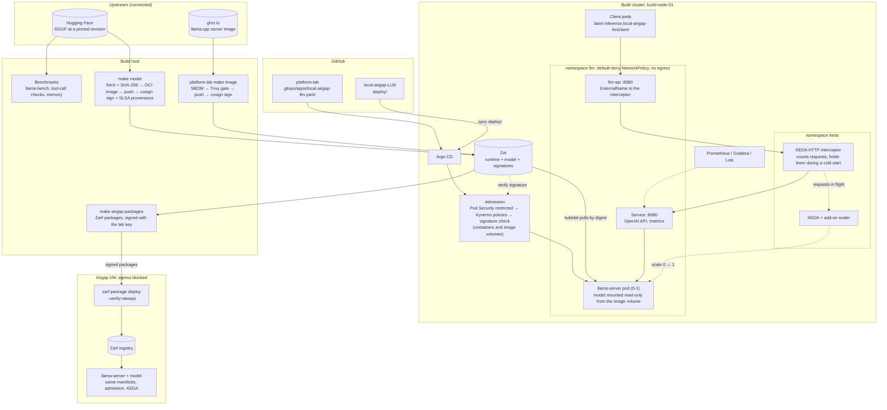

# Stack and pipeline

The full technical specification of local-airgap-LLM: every tool and
component, its version, what it does here and why it was chosen; then the
pipeline from a model on Hugging Face to a completion in the cluster, how
data moves at run time, and a diagram. Decisions are recorded in
[adr/](adr/); measurements in [benchmarks/](../benchmarks/README.md).

The clusters themselves (VMs, hardening, RKE2, Argo CD, Zot, Kyverno,
cosign, monitoring, Velero, Zarf) come from
[platform-lab](https://github.com/JGGHalfhide/platform-lab); its
[docs/stack.md](https://github.com/JGGHalfhide/platform-lab/blob/main/docs/stack.md)
describes them in full. This page lists them only for what they do for the
inference workload.

Current as of v1.1 (11/23): everything below is built, measured, and was
rebuilt from fresh clones of both repos
([scans/week6-rebuild.txt](scans/week6-rebuild.txt)).

## Tech stack

### Hardware and VMs

| Component | Version | What it does here | Why |
|---|---|---|---|
| Build host | GMKtec K8 Plus, Ryzen 7 8845HS (8 cores / 16 threads, AVX-512), 32 GB (28.2 GiB usable), Arch Linux | Runs both VMs, the benchmarks, `make model` and the Zarf builds | Personal hardware; AVX-512 makes CPU inference practical |
| build-node-01 | Rocky 9 VM, 8 vCPU / 16 GiB / 40 GiB in Phase 2; 12 vCPU / 20 GiB since 11/23 (local-agents docs/resource-plan.md) | Connected build cluster: the model is published and served here first; the Zarf packages are built from its registry | Resized from 4 vCPU / 12 GiB for inference ([resource-plan.md](resource-plan.md)) |
| Airgap target | Rocky 9 VM (platform-lab `airgap_rehearsal`, 192.168.122.20), 8 vCPU / 16 GiB / 60 GiB in Phase 2; 12 vCPU / 20 GiB since 11/23 | Disconnected cluster: egress blocked, everything arrives as signed Zarf packages | Replaces the 8 GB iMac, too small for the model next to the platform. The two VMs run one at a time (2 x 16 GiB, now 2 x 20 GiB, does not fit in 28 GiB with the host) |
| libvirt `host-passthrough` CPU | | The guests see the host's AVX-512 | llama.cpp picks the same `zen4` kernels in the VM as on the host |
| Radeon 780M iGPU | | Not used | CPU-only decided 11/20; a stretch goal at most |

### Model selection and benchmarking

| Component | Version | What it does here | Why |
|---|---|---|---|
| Hugging Face Hub | pinned revisions | Source of the GGUF files, from the official publishers (ggml-org, ibm-granite, mistralai) | Official GGUF builds with SHA-256 in the LFS metadata |
| `benchmarks/candidates.tsv` | | Five candidates: name, repo, revision, file, SHA-256, license | One pinned list used by every script |
| `scripts/fetch-models.sh` | curl, sha256sum | Downloads each GGUF at its pinned revision into `models/` (gitignored) and checks its SHA-256 | Models pinned by checksum like every other input |
| llama.cpp (host build) | v1.0.0, commit `b1b770d9` (`scripts/build-llama-bench.sh`) | `llama-bench`, `llama-server` built natively for the host benchmarks | Same commit as the runtime image, so host and cluster numbers compare |
| `scripts/bench.py` | Python 3 | Thread sweep and 4k-context runs with `llama-bench`, results as JSON | Repeatable numbers per model ([benchmarks/README.md](../benchmarks/README.md)) |
| `scripts/toolcall-check.py` | Python 3 | Five tool-calling and structured-output cases against `llama-server` | Phase 3 agents depend on tool calls, not only tokens/s |
| `scripts/server-mem.sh` | | Peak server memory per setting (context size, mmap or not) | Sized the pod: `--load-mode none` saves 1.2 GiB |
| `scripts/thinking-check.py` | Python 3 | Qwen3.5 thinking on vs off on ten checkable prompts, the server-wide switches, and a thinking budget | Set the server default ([ADR 0006](adr/0006-thinking-off-by-default.md)) |
| `benchmarks/k8s/llama-bench-job.yaml` | | The same benchmark as a Job in the build VM | Measures VM and platform overhead; chose `-t 6 -tb 8` |

Result: Qwen3.5 4B Q4_K_M, Apache-2.0
([ADR 0002](adr/0002-qwen3.5-4b-q4km-model.md)); fallback Granite 4.2 3B
Q4_K_M.

### Runtime

| Component | Version | What it does here | Why |
|---|---|---|---|
| llama.cpp `llama-server` | v1.0.0 (`ghcr.io/ggml-org/llama.cpp:server-v1.0.0-b12359-b1b770d`, `sha256:e3032ea0…`) | OpenAI-compatible API (`/v1/chat/completions`), tool calls through the model's chat template (`--jinja`), JSON-schema output, Prometheus `/metrics` | CPU-first, reads GGUF from a path, runs as non-root, one image ([ADR 0001](adr/0001-llama-cpp-server-runtime.md)) |
| Server settings | `--ctx-size 32768`, 4 slots sharing the KV cache, `--load-mode none`, `--cache-ram 0`, `--ctx-checkpoints 4`, `--reasoning off --reasoning-budget 1024`, `--threads 6 --threads-batch 8`, `--metrics`, `--no-webui` | Peak 5.0 GiB with 4 concurrent requests; 6 threads for generation, 8 for prompts (server timings: ~120 prompt tok/s at 800 tokens, 80 at 29.7k; ~14.5 generation tok/s) | Measured in Weeks 1, 3, 4 and 6 ([benchmarks/README.md](../benchmarks/README.md), [resource-plan.md](resource-plan.md)). `--cache-ram 0`: the default 8 GiB RAM prompt cache got the pod OOMKilled under load ([load-test.md](load-test.md#finding-oomkilled-under-load-fixed)). `--ctx-checkpoints 4`: the default 32 per slot got it OOMKilled under agent tool loops ([ADR 0007](adr/0007-context-checkpoints-capped-at-4.md)). Thinking off unless a request opts in, then at most 1024 tokens ([ADR 0006](adr/0006-thinking-off-by-default.md)) |
| platform-lab `make image` | | Publishes the runtime image: crane pull, Syft SBOM, Trivy gate, push to Zot, cosign sign + SBOM attestation | The same path as every platform image |

### Model supply chain

| Component | Version | What it does here | Why |
|---|---|---|---|
| `make model` (`scripts/publish-model.sh`) | | Fetch and check, build, push, sign, attest, verify; skips push and signing when the digest is already signed | One command from a pinned row to a signed image ([model-image.md](model-image.md)) |
| `scripts/build-model-image.py` | Python 3 (standard library) | Writes an OCI layout: one linux/amd64 manifest, one uncompressed layer with the GGUF (mode 0444, owner 0:0, mtime 0), provenance as annotations | Same file in, same digest out; no container build tool needed ([ADR 0003](adr/0003-model-as-oci-image-volume.md)) |
| OCI image (model) | `models/qwen3.5-4b-q4km:hf-8d43d974efc4@sha256:fb1e513b…`, 2.8 GiB | The model as a data-only image, mounted as an image volume | Pulled, cached, verified and carried like any image |
| crane | go-containerregistry | Pushes the layout to Zot; checks the pushed digest | Pushes byte for byte |
| cosign | v3.1.3 | Signs the manifest digest and attaches a SLSA v1 provenance attestation with the lab key; no Rekor, tag-based `.sig`/`.att` | Same key and flags as platform-lab, verifiable offline and by Kyverno and Zarf |
| SLSA provenance v1 | in-toto statement | Records source URL, revision, upstream SHA-256, license, quantization and this repo's commit | Where the model came from, signed; replaces the SBOM a data file cannot have |
| platform-lab `scripts/lib.sh` | | Registry login with a throwaway config, lab CA trust, Vault access | Reused, not copied |
| Zot | v2.1.23 (platform-lab) | Stores the runtime and model images and their signatures; Kyverno verifies against it | The platform registry |

### Delivery and serving

| Component | Version | What it does here | Why |
|---|---|---|---|
| Argo CD | v3.6.1 (platform-lab) | Application `local-airgap-llm` in platform-lab's root app syncs this repo's `deploy/` (automated, prune, self-heal) | Same GitOps flow as every platform app |
| Kustomize | built into Argo CD | `deploy/llm/` (namespace `llm`: server, Services, NetworkPolicies, ServiceMonitor, scaling) and `deploy/monitoring/` (dashboard ConfigMap in `monitoring`) | No templating needed; two parts because Grafana only loads dashboards from `monitoring` |
| Deployment + Service | Kubernetes 1.36.5 (RKE2) | `llama-server`, 0 or 1 replicas (KEDA owns the count), `Recreate` updates (two copies do not fit), ClusterIP Service on 8080 | Smallest serving layer that does the job ([ADR 0004](adr/0004-plain-deployment-serving-layer.md)) |
| Image volume | Kubernetes 1.36, containerd 2.3.4 | The kubelet pulls the model image and mounts it read-only at `/models` | No init container, no copy, verified at admission ([ADR 0003](adr/0003-model-as-oci-image-volume.md)) |
| Namespace `llm` | | Restricted Pod Security (enforce, warn, audit) | The platform default; no exception needed |
| NetworkPolicy | Canal (RKE2) | `llm`: default deny in and out; the server admits only the KEDA interceptor and Prometheus on 8080. `keda` (platform-lab): the interceptor's proxy port admits only pods and namespaces labelled `inference.local-airgap-llm/client: "true"` | The server needs no egress at all; clients opt in explicitly and cannot bypass the request count that keeps the server up |
| Pod settings | | Non-root UID 65532, read-only root filesystem, no capabilities, no service account token, requests 4 CPU / 5 GiB, limit 6 GiB, no CPU limit | Passes all platform-lab policies as written |
| Entry point `llm-api` | ExternalName Service | Clients call `http://llm-api.llm.svc:8080`, which resolves to the KEDA HTTP add-on's interceptor | One stable name whether the server runs or not ([ADR 0005](adr/0005-keda-http-add-on-scale-to-zero.md)) |

### Scaling

| Component | Version | What it does here | Why |
|---|---|---|---|
| KEDA | v2.21.1 (platform-lab `gitops/keda`) | Operator, metrics API server and admission webhooks; turns the ScaledObject into an HPA and scales 0 ↔ 1 itself | Event-driven autoscaling including to zero ([ADR 0005](adr/0005-keda-http-add-on-scale-to-zero.md)) |
| KEDA HTTP add-on | v0.16.0 (platform-lab `gitops/keda`) | Interceptor (proxy that counts requests in flight and holds them during a cold start), scaler (feeds the count to KEDA), operator | KEDA alone cannot wake an HTTP server from zero; beta, but stable |
| InterceptorRoute `llama-server` | `deploy/llm/scaling.yaml` | Routes `llm-api.llm.svc` to the Service; concurrency target 4 (the slots); holds up to 32 requests, waits up to 180 s for readiness; no response timeouts | Long prompts take minutes; non-streamed replies send headers only at the end |
| ScaledObject `llama-server` | `deploy/llm/scaling.yaml` | 0-1 replicas, 5 min cooldown, `external-push` trigger from the add-on scaler | Frees 5-6 GiB when idle; one replica fits ([scaling.md](scaling.md)) |
| Supply chain | `make image` (platform-lab) | All six images signed in Zot, pinned by digest; projected API tokens; the add-on's three under a scoped Trivy exception (CVE-2026-77524 in a library they link but do not call) | Same rules as every platform image |

### Airgap

| Component | Version | What it does here | Why |
|---|---|---|---|
| Zarf | v0.89.0 (platform-lab) | Packages images, their cosign signatures and attestations, and manifests into signed archives; on the node: `zarf init` (in-cluster registry, mutating agent), then `zarf package deploy --key cosign.pub --verify=always` | The platform-lab airgap path; a package with a bad or missing signature is not deployed |
| `zarf/llm` | package 0.5.0, 3.7 GB | Runtime and model images (with `.sig` and `.att`, listed explicitly: Zarf does not pick up cosign's tag-based artifacts), the `deploy/` manifests, the dashboard | The same manifests and digests as the build cluster |
| `zarf/llm-smoke` | package 0.5.0, 3.1 GB | The alpine client image and an unsigned copy of the model image, for `make smoke` | The smoke test cannot build the unsigned copy without the build registry |
| platform-lab airgap flow | `make airgap-stage`, `airgap-up`, `airgap-disconnect`; this repo's `make airgap-packages`, `make airgap-deploy` | RKE2 from staged RPMs and images; firewalld policies block egress (checked: `curl` must fail); the zarf role deploys platform-lab's packages, then this repo's (`zarf_extra_packages`), skipping unchanged ones | Reused, not copied; idempotent (repeat run `changed=0`) |
| Zarf registry and agent | `127.0.0.1:31999`, 20Gi PVC | The agent rewrites every image reference, image volumes included, to the Zarf registry; Kyverno's airgap policy variant verifies the rewritten references against the same key | One registry for the platform and the 2.8 GiB model |
| `scripts/zarf-pull-secret.sh` | | Copies Zarf's `private-registry` pull Secret into namespaces created after deploy (smoke and cold-start test namespaces); no-op on the build cluster | Zarf creates the Secret only in namespaces that exist when it deploys |

### Admission

| Component | Version | What it does here | Why |
|---|---|---|---|
| Pod Security admission | built in | `restricted` on `llm` | First layer, from the API server |
| Kyverno | v1.19.2 (platform-lab) | Eight ValidatingPolicies (privileged, hostPath, restricted controls, latest tag, resources, labels, trusted registries, Secrets in env) and `verify-platform-images` | The platform's policy set, unchanged for this workload |
| `verify-platform-images` | platform-lab 250acd1 | Checks containers **and image volumes**: digest-pinned and signed with the lab key, verified against Zot | An unsigned or tampered model is rejected before the pod exists |

### Testing and CI

| Component | Version | What it does here | Why |
|---|---|---|---|
| `make smoke` (`scripts/smoke-test.sh`) | | Completion through `llm-api` (waking the server if needed); unlabelled pod blocked; no bypass of the interceptor; no egress from the server; unsigned model copy rejected; no thinking unless asked (ADR 0006). Detects the airgapped cluster (its `zarf` namespace) and uses the Zarf registry and the llm-smoke package there | The acceptance test, rerunnable on either cluster ([scans/week3-smoke-test.txt](scans/week3-smoke-test.txt), [airgap-runbook.md](airgap-runbook.md)) |
| `scripts/cold-start.sh` | | Waits for zero replicas, then times a streamed request from a client pod and reads the pod's timeline | Cold start from zero, client side ([scaling.md](scaling.md)) |
| `make load-test` (`scripts/load-test.py`) | | Streamed requests at concurrency 1/2/4/8 through the interceptor: TTFT, p50/p95 latency, tokens/s, errors, and CPU package energy from RAPL | Throughput and energy per token, Python stdlib only ([load-test.md](load-test.md)) |
| RAPL (Linux powercap) | `/sys/class/powercap/intel-rapl:0` | CPU package energy counter on the host, read with `sudo` before and after each load level | Measured energy per token without a wall meter; a lower bound (no DRAM, SSD or PSU losses) |
| yamllint | 1.38.0 | `make lint`, CI | Same rules as platform-lab |
| gitleaks | 8.30.1 | Full-history secret scan in CI | No secrets, kubeconfigs or weights committed |
| GitHub Actions | `.github/workflows/ci.yml` | yamllint and gitleaks on every push and pull request | Checks without the lab |

### Observability

| Component | Version | What it does here | Why |
|---|---|---|---|
| llama-server `/metrics` + ServiceMonitor | `deploy/llm/servicemonitor.yaml` | Prometheus scrapes token counters and timers, requests processing/deferred, busy slots every 15 s | Server-side throughput and load; no latency histograms exist, so TTFT and percentiles are client side ([observability.md](observability.md)) |
| Grafana dashboard | `scripts/gen-dashboard.py` → `deploy/monitoring/dashboards/llama-server.json` | Status, throughput, load, memory and CPU, replicas and restarts | Dashboard as code, generated, in the `local-airgap-llm` folder |
| Loki + Alloy | platform-lab | Server and KEDA logs; no prompt or response content (default verbosity, checked) | Prompts stay out of the log store by default ([observability.md](observability.md#logs)) |

## Pipeline

### 1. Choose a model (Week 1)

1. Pin candidates in `benchmarks/candidates.tsv` (official GGUF publishers,
   openly licensed, revision + SHA-256).
2. `scripts/fetch-models.sh`: download and check.
3. Host benchmarks: `scripts/bench.py` (speed), `scripts/toolcall-check.py`
   (tool calls, structured output), `scripts/server-mem.sh` (memory).
4. In-cluster benchmark Job on build-node-01: VM overhead, thread settings.
5. Record the decision as ADRs 0001 (runtime) and 0002 (model).

### 2. Publish the runtime (platform-lab)

`make image IMAGE=ghcr.io/ggml-org/llama.cpp:server-v1.0.0-b12359-b1b770d`
in platform-lab: SBOM, Trivy gate, push to Zot with the upstream digest,
cosign signature and SBOM attestation.

### 3. Publish the model: `make model`

1. Fetch the GGUF at its pinned revision; check its SHA-256.
2. Build a one-layer OCI image (deterministic; the SHA-256 is checked again
   while copying) with provenance annotations.
3. Push to `registry.platform-lab.internal/models/<name>:hf-<revision>`;
   check the pushed digest.
4. cosign: sign the digest, attach the SLSA v1 provenance attestation,
   verify both and the attested SHA-256.

### 4. Deploy: Git push → Argo CD

1. Change `deploy/` (for a new model: the image volume digest and
   `--model` path) and push to `main`.
2. Argo CD syncs the `local-airgap-llm` Application into `llm`.
3. Admission: Pod Security, then Kyverno's policies, then
   `verify-platform-images` on both the runtime image and the model image
   volume.
4. The kubelet pulls both images from Zot (`127.0.0.1:30500`, by digest),
   mounts the model read-only, and starts `llama-server`. The startup probe
   waits for `/health` (model loaded in about 4 s; ready in about 6 s with
   the images cached).

### 5. Scale: KEDA (Week 4)

Idle for 5 minutes, KEDA scales `llama-server` to zero. A request to
`llm-api` reaches the interceptor, which holds it, reports one request in
flight to KEDA, and forwards it once the pod is ready; KEDA keeps the pod
while requests are in flight and for the cooldown after. Cold start:
[scaling.md](scaling.md).

### 6. Verify: `make smoke`

Completion through `llm-api` (with no thinking unless the request asks for
it), NetworkPolicy (unlabelled pod blocked, no bypass of the interceptor,
no egress), and an unsigned copy of the model image rejected at admission
(server-side dry run).

### 7. Airgap (Week 5)

1. On the build host, with the build cluster running: `make smoke` (makes
   the unsigned model copy), platform-lab's `make airgap-packages`, then
   this repo's `make airgap-packages`: images, signatures and attestations
   pulled from Zot by digest, packages signed with the lab key and checked.
2. Shut down the build VM; start (or, after a teardown, create with
   `make rehearsal`) the airgap VM.
3. platform-lab: `make airgap-stage` (once), `make airgap-up` (RKE2 from
   staged artifacts), `make airgap-disconnect` (egress blocked, checked).
4. `make airgap-deploy`: `zarf init`, then each package with
   `--verify=always` against the lab key. Admission verifies the rewritten
   references again.
5. `make smoke` and `scripts/cold-start.sh` on the airgapped cluster.

Step by step with results: [airgap-runbook.md](airgap-runbook.md).

### 8. Measure (Week 6)

`make load-test`: concurrency 1/2/4/8 through the interceptor, TTFT,
p50/p95, tokens/s, errors, and energy per token from RAPL
([load-test.md](load-test.md)).

### 9. Rebuild from nothing (Week 6)

`make down` in platform-lab, fresh clones of both repos, then the READMEs'
quickstarts and the airgap runbook: about 47 minutes of steps for both
clusters, the model image rebuilt to the same digest
([scans/week6-rebuild.txt](scans/week6-rebuild.txt)).

## Data flow

**Model bytes.** Hugging Face (pinned revision) → `models/` on the build
host (SHA-256 checked) → OCI layout in `build/` (checked again) → Zot over
TLS (digest checked, signed) → containerd on the node (pulled by the
kubelet after Kyverno verified the signature) → read-only mount `/models`
→ `llama-server` loads it into memory (no mmap) and repacks the weights for
the CPU. Nothing in the pod downloads anything.

**A request.** Client pod (labelled, in a labelled namespace) →
`llm-api.llm.svc:8080` (ExternalName) → KEDA interceptor in `keda` (its
NetworkPolicy checks the client labels; it counts the request and, if the
server is at zero, holds it while KEDA starts the pod) → Service
`llama-server.llm.svc:8080` (NetworkPolicy: only the interceptor) →
`llama-server` applies the chat template, processes the prompt (8
threads), generates (6 threads) in one of 4 slots, returns OpenAI-format
JSON (or a stream) with token counts and timings. The server cannot open
any connection out.

**Metrics and logs.** Prometheus scrapes `/metrics` on 8080 (allowed by
the NetworkPolicy); Alloy ships the pods' logs to Loki, without prompt
content.

**Trust.** One cosign key (platform-lab's lab key, public half in
`pki/cosign.pub` there) signs the runtime and the model; Kyverno checks it
at admission on the build cluster, Zarf and Kyverno on the airgapped one.

## Diagram

Mermaid source; GitHub renders it, and it can be pasted into any Mermaid
editor to export or redraw.

