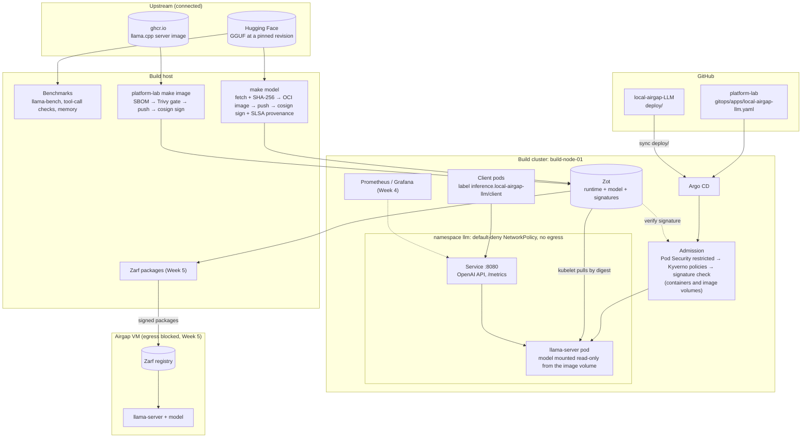

# Stack and pipeline

The full technical specification of local-airgap-LLM: every tool and
component, its version, what it does here and why it was chosen; then the
pipeline from a model on Hugging Face to a completion in the cluster, how
data moves at run time, and a diagram. Decisions are recorded in
[adr/](adr/); measurements in [benchmarks/](../benchmarks/README.md).

The clusters themselves (VMs, hardening, RKE2, Argo CD, Zot, Kyverno,
cosign, monitoring, Velero, Zarf) come from
[platform-lab](https://github.com/JGGHalfhide/platform-lab); its
[docs/stack.md](https://github.com/JGGHalfhide/platform-lab/blob/main/docs/stack.md)
describes them in full. This page lists them only for what they do for the
inference workload.

Rows marked *planned* are on the [roadmap](../ROADMAP.md) and not built yet.

## Tech stack

### Hardware and VMs

| Component | Version | What it does here | Why |
|---|---|---|---|
| Build host | GMKtec K8 Plus, Ryzen 7 8845HS (8 cores / 16 threads, AVX-512), 32 GB (28.2 GiB usable), Arch Linux | Runs both VMs, the benchmarks, `make model` and the Zarf builds | Personal hardware; AVX-512 makes CPU inference practical |
| build-node-01 | Rocky 9 VM, 8 vCPU / 12 GiB / 40 GiB | Connected build cluster: the model is published and served here first | Resized from 4 vCPU for inference ([resource-plan.md](resource-plan.md)) |
| Airgap target | Rocky 9 VM (platform-lab `airgap_rehearsal`), 8 vCPU / 12 GiB / 60 GiB | Disconnected cluster for Week 5 | Replaces the 8 GB iMac, too small for the model next to the platform |
| libvirt `host-passthrough` CPU | | The guests see the host's AVX-512 | llama.cpp picks the same `zen4` kernels in the VM as on the host |
| Radeon 780M iGPU | | Not used | CPU-only decided 11/20; a stretch goal at most |

### Model selection and benchmarking

| Component | Version | What it does here | Why |
|---|---|---|---|
| Hugging Face Hub | pinned revisions | Source of the GGUF files, from the official publishers (ggml-org, ibm-granite, mistralai) | Official GGUF builds with SHA-256 in the LFS metadata |
| `benchmarks/candidates.tsv` | | Five candidates: name, repo, revision, file, SHA-256, license | One pinned list used by every script |
| `scripts/fetch-models.sh` | curl, sha256sum | Downloads each GGUF at its pinned revision into `models/` (gitignored) and checks its SHA-256 | Models pinned by checksum like every other input |
| llama.cpp (host build) | v1.0.0, commit `b1b770d9` (`scripts/build-llama-bench.sh`) | `llama-bench`, `llama-server` built natively for the host benchmarks | Same commit as the runtime image, so host and cluster numbers compare |
| `scripts/bench.py` | Python 3 | Thread sweep and 4k-context runs with `llama-bench`, results as JSON | Repeatable numbers per model ([benchmarks/README.md](../benchmarks/README.md)) |
| `scripts/toolcall-check.py` | Python 3 | Five tool-calling and structured-output cases against `llama-server` | Phase 3 agents depend on tool calls, not only tokens/s |
| `scripts/server-mem.sh` | | Peak server memory per setting (context size, mmap or not) | Sized the pod: `--load-mode none` saves 1.2 GiB |
| `benchmarks/k8s/llama-bench-job.yaml` | | The same benchmark as a Job in the build VM | Measures VM and platform overhead; chose `-t 6 -tb 8` |

Result: Qwen3.5 4B Q4_K_M, Apache-2.0
([ADR 0002](adr/0002-qwen3.5-4b-q4km-model.md)); fallback Granite 4.2 3B
Q4_K_M.

### Runtime

| Component | Version | What it does here | Why |
|---|---|---|---|
| llama.cpp `llama-server` | v1.0.0 (`ghcr.io/ggml-org/llama.cpp:server-v1.0.0-b12359-b1b770d`, `sha256:e3032ea0…`) | OpenAI-compatible API (`/v1/chat/completions`), tool calls through the model's chat template (`--jinja`), JSON-schema output, Prometheus `/metrics` | CPU-first, reads GGUF from a path, runs as non-root, one image ([ADR 0001](adr/0001-llama-cpp-server-runtime.md)) |
| Server settings | `--ctx-size 8192`, 4 slots sharing the KV cache, `--load-mode none`, `--threads 6 --threads-batch 8`, `--metrics`, `--no-webui` | 3.9 GiB peak; 6 threads for generation, 8 for prompts (confirmed from server timings: ~120 prompt tok/s, ~14.5 generation tok/s) | Measured in Weeks 1 and 3 ([benchmarks/README.md](../benchmarks/README.md)) |
| platform-lab `make image` | | Publishes the runtime image: crane pull, Syft SBOM, Trivy gate, push to Zot, cosign sign + SBOM attestation | The same path as every platform image |

### Model supply chain

| Component | Version | What it does here | Why |
|---|---|---|---|
| `make model` (`scripts/publish-model.sh`) | | Fetch and check, build, push, sign, attest, verify; skips push and signing when the digest is already signed | One command from a pinned row to a signed image ([model-image.md](model-image.md)) |
| `scripts/build-model-image.py` | Python 3 (standard library) | Writes an OCI layout: one linux/amd64 manifest, one uncompressed layer with the GGUF (mode 0444, owner 0:0, mtime 0), provenance as annotations | Same file in, same digest out; no container build tool needed ([ADR 0003](adr/0003-model-as-oci-image-volume.md)) |
| OCI image (model) | `models/qwen3.5-4b-q4km:hf-8d43d974efc4@sha256:fb1e513b…`, 2.8 GiB | The model as a data-only image, mounted as an image volume | Pulled, cached, verified and carried like any image |
| crane | go-containerregistry | Pushes the layout to Zot; checks the pushed digest | Pushes byte for byte |
| cosign | v3.1.3 | Signs the manifest digest and attaches a SLSA v1 provenance attestation with the lab key; no Rekor, tag-based `.sig`/`.att` | Same key and flags as platform-lab, verifiable offline and by Kyverno and Zarf |
| SLSA provenance v1 | in-toto statement | Records source URL, revision, upstream SHA-256, license, quantization and this repo's commit | Where the model came from, signed; replaces the SBOM a data file cannot have |
| platform-lab `scripts/lib.sh` | | Registry login with a throwaway config, lab CA trust, Vault access | Reused, not copied |
| Zot | v2.1.23 (platform-lab) | Stores the runtime and model images and their signatures; Kyverno verifies against it | The platform registry |

### Delivery and serving

| Component | Version | What it does here | Why |
|---|---|---|---|
| Argo CD | v3.6.1 (platform-lab) | Application `local-airgap-llm` in platform-lab's root app syncs this repo's `deploy/` (automated, prune, self-heal) | Same GitOps flow as every platform app |
| Kustomize | built into Argo CD | `deploy/kustomization.yaml`: namespace, labels, resources | No templating needed for one Deployment |
| Deployment + Service | Kubernetes 1.36.5 (RKE2) | One `llama-server` replica, `Recreate` updates (two copies do not fit), ClusterIP Service on 8080 | Smallest serving layer that does the job ([ADR 0004](adr/0004-plain-deployment-serving-layer.md)) |
| Image volume | Kubernetes 1.36, containerd 2.3.4 | The kubelet pulls the model image and mounts it read-only at `/models` | No init container, no copy, verified at admission ([ADR 0003](adr/0003-model-as-oci-image-volume.md)) |
| Namespace `llm` | | Restricted Pod Security (enforce, warn, audit) | The platform default; no exception needed |
| NetworkPolicy | Canal (RKE2) | Default deny in and out; ingress on 8080 only from pods and namespaces labelled `inference.local-airgap-llm/client: "true"`, and from Prometheus | The server needs no egress at all; clients opt in explicitly |
| Pod settings | | Non-root UID 65532, read-only root filesystem, no capabilities, no service account token, requests 4 CPU / 4 GiB, limit 5 GiB | Passes all platform-lab policies as written |

### Admission

| Component | Version | What it does here | Why |
|---|---|---|---|
| Pod Security admission | built in | `restricted` on `llm` | First layer, from the API server |
| Kyverno | v1.19.2 (platform-lab) | Eight ValidatingPolicies (privileged, hostPath, restricted controls, latest tag, resources, labels, trusted registries, Secrets in env) and `verify-platform-images` | The platform's policy set, unchanged for this workload |
| `verify-platform-images` | platform-lab 250acd1 | Checks containers **and image volumes**: digest-pinned and signed with the lab key, verified against Zot | An unsigned or tampered model is rejected before the pod exists |

### Testing and CI

| Component | Version | What it does here | Why |
|---|---|---|---|
| `make smoke` (`scripts/smoke-test.sh`) | | Completion from a client pod; unlabelled pod blocked; no egress from the server; unsigned model copy rejected | The Week 3 acceptance test, rerunnable on either cluster ([scans/week3-smoke-test.txt](scans/week3-smoke-test.txt)) |
| yamllint | 1.38.0 | `make lint`, CI | Same rules as platform-lab |
| gitleaks | 8.30.1 | Full-history secret scan in CI | No secrets, kubeconfigs or weights committed |
| GitHub Actions | `.github/workflows/ci.yml` | yamllint and gitleaks on every push and pull request | Checks without the lab |

### Planned (Weeks 4-6)

| Component | What it will do | Week |
|---|---|---|
| ServiceMonitor + Grafana dashboard | Scrape `llama-server` `/metrics`; tokens/s, time to first token, p50/p95, requests in flight, memory | 4 |
| KEDA | Scale the Deployment on requests in flight or queue depth, including to zero; measure cold start | 4 |
| Loki (platform-lab) | Server logs, with no prompt content logged by default | 4 |
| Zarf | Packages for the runtime, the model image and its signatures, KEDA, manifests and dashboard, signed on the host and deployed with egress blocked | 5 |
| k6 or a small script | Load test at concurrency 1/2/4/8; cost per million tokens from measured power draw | 6 |

## Pipeline

### 1. Choose a model (Week 1)

1. Pin candidates in `benchmarks/candidates.tsv` (official GGUF publishers,
   openly licensed, revision + SHA-256).
2. `scripts/fetch-models.sh`: download and check.
3. Host benchmarks: `scripts/bench.py` (speed), `scripts/toolcall-check.py`
   (tool calls, structured output), `scripts/server-mem.sh` (memory).
4. In-cluster benchmark Job on build-node-01: VM overhead, thread settings.
5. Record the decision as ADRs 0001 (runtime) and 0002 (model).

### 2. Publish the runtime (platform-lab)

`make image IMAGE=ghcr.io/ggml-org/llama.cpp:server-v1.0.0-b12359-b1b770d`
in platform-lab: SBOM, Trivy gate, push to Zot with the upstream digest,
cosign signature and SBOM attestation.

### 3. Publish the model: `make model`

1. Fetch the GGUF at its pinned revision; check its SHA-256.
2. Build a one-layer OCI image (deterministic; the SHA-256 is checked again
   while copying) with provenance annotations.
3. Push to `registry.platform-lab.internal/models/<name>:hf-<revision>`;
   check the pushed digest.
4. cosign: sign the digest, attach the SLSA v1 provenance attestation,
   verify both and the attested SHA-256.

### 4. Deploy: Git push → Argo CD

1. Change `deploy/` (for a new model: the image volume digest and
   `--model` path) and push to `main`.
2. Argo CD syncs the `local-airgap-llm` Application into `llm`.
3. Admission: Pod Security, then Kyverno's policies, then
   `verify-platform-images` on both the runtime image and the model image
   volume.
4. The kubelet pulls both images from Zot (`127.0.0.1:30500`, by digest),
   mounts the model read-only, and starts `llama-server`. The startup probe
   waits for `/health` (model loaded in about 4 s; ready in about 6 s with
   the images cached).

### 5. Verify: `make smoke`

Completion through the Service, NetworkPolicy both ways, and an unsigned
copy of the model image rejected at admission (server-side dry run).

### 6. Airgap (Week 5, planned)

Zarf packages built on the host from the same digests, signatures
included, carried to the airgap VM, deployed with `--verify=always`; the
same manifests and `make smoke` on the disconnected cluster.

## Data flow

**Model bytes.** Hugging Face (pinned revision) → `models/` on the build
host (SHA-256 checked) → OCI layout in `build/` (checked again) → Zot over
TLS (digest checked, signed) → containerd on the node (pulled by the
kubelet after Kyverno verified the signature) → read-only mount `/models`
→ `llama-server` loads it into memory (no mmap) and repacks the weights for
the CPU. Nothing in the pod downloads anything.

**A request.** Client pod (labelled, in a labelled namespace) → Service
`llama-server.llm.svc:8080` → NetworkPolicy allows it → `llama-server`
applies the chat template, processes the prompt (8 threads), generates
(6 threads) in one of 4 slots, returns OpenAI-format JSON with token counts
and timings. The server cannot open any connection out.

**Metrics and logs (Week 4).** Prometheus scrapes `/metrics` on 8080 (allowed
by the NetworkPolicy); Alloy ships the pod's logs to Loki.

**Trust.** One cosign key (platform-lab's lab key, public half in
`pki/cosign.pub` there) signs the runtime and the model; Kyverno checks it
at admission on the build cluster, Zarf and Kyverno on the airgapped one.

## Diagram

Mermaid source; GitHub renders it, and it can be pasted into any Mermaid
editor to export or redraw.

